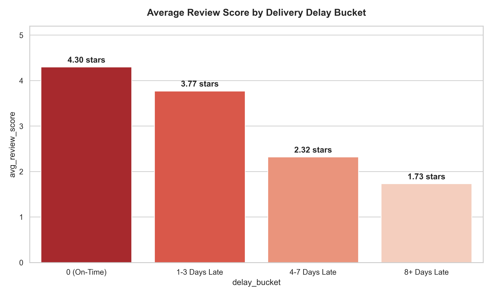
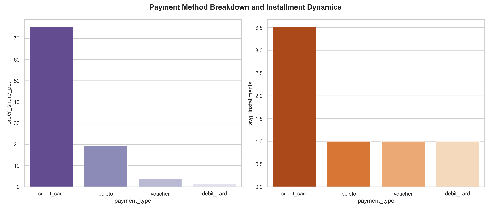
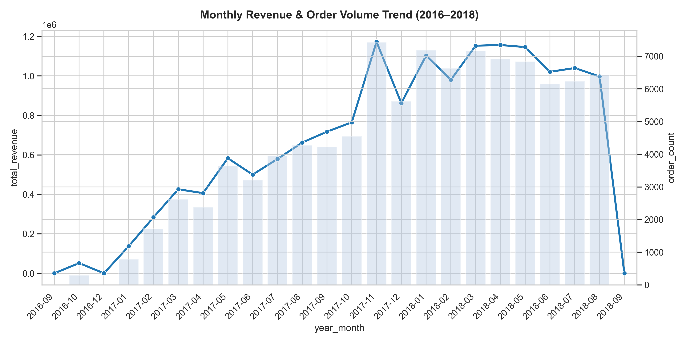
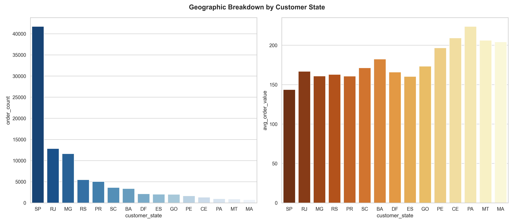
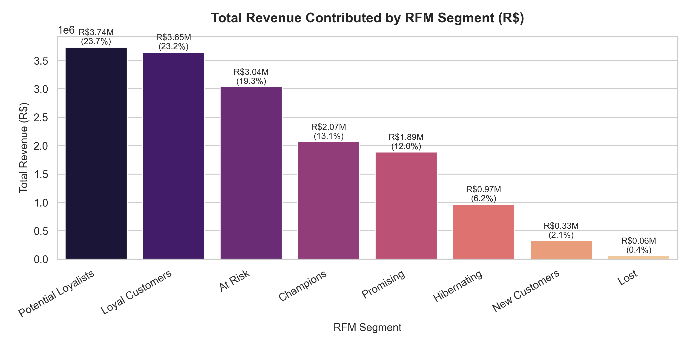

# Olist Brazilian E-Commerce Data Pipeline & Analysis

> An end-to-end Python data pipeline, relational SQLite analytics platform, and interactive Streamlit web dashboard built for the Olist Brazilian E-Commerce public dataset according to an IEEE 830 SRS document.

---

## Dataset Source
This project uses the **Olist Brazilian E-Commerce Public Dataset** available on Kaggle, containing **99,441 commercial orders** placed across Brazil between September 2016 and October 2018.

---

## What This Project Does

1. **Phase 1: Ingestion & Data Cleaning**
   - Zero-pads 5-digit zip code prefixes (`zfill(5)`).
   - Converts timestamp columns to ISO `datetime64[ns]`.
   - Merges Portuguese-to-English product category translations.
   - Retains missing written review texts without row deletion; flags missing categories and physical dimensions.
   - Deduplicates order reviews by `review_id` and builds two denormalized analytical tables (`olist_analysis_orders` and `olist_analysis_items`).
   - Exports clean datasets in Parquet and CSV formats to `data/clean/`.

2. **Phase 2: Database Loading & Verification**
   - Loads a normalized relational schema matching the source domain into a SQLite database (`db/olist.db`).
   - Enforces `PRIMARY KEY` and `FOREIGN KEY` constraints with explicit indexes on foreign keys and `order_purchase_timestamp`.
   - Executes 5 automated SQL sanity checks to verify 100% row counts, zero orphaned records, and date boundaries.

3. **Phase 3: Exploratory Data Analysis & Visualization**
   - Queries the database to answer 7 core business questions.
   - Generates publication-quality charts saved to `eda_charts/`.
   - Produces a comprehensive PDF report (`report.pdf`).

4. **FR-2 & FR-3: Sales Trend & Product Basket Analysis**
   - Reusable `get_sales_trend` function for multi-granular revenue & order volume trend analysis.
   - Statistical demand spike detection (rolling 30-day 2-std-dev threshold highlighting Black Friday).
   - 30-day sales forecasting via Prophet / Holt-Winters Exponential Smoothing.
   - Category-level market-basket association rule mining via Apriori / `mlxtend`.
   - Reusable `get_category_drilldown` function for category product performance analysis.

5. **FR-4: Customer Buying Pattern & RFM Segmentation**
   - Per-customer metrics (`customer_unique_id`): order frequency, total spend, AOV, first/last purchase dates.
   - Overall repeat purchase rate (3.04%) and orders-per-customer distribution analysis.
   - RFM segmentation (Recency, Frequency, Monetary quintiles via pandas `qcut` + `rank`) mapping customers into 8 standard segments (Champions, Loyal Customers, Potential Loyalists, New Customers, Promising, At Risk, Hibernating, Lost).
   - Day-of-week by hour-of-day peak purchase times heatmap analysis (Peak: Tuesdays at 14:00).
   - Reusable `get_customer_insights(state, segment)` function for filtered metric extraction.

6. **FR-5: Interactive Dashboard & Automated Reporting**
   - Single-page interactive web application built with Streamlit (`dashboard.py`).
   - 4 multi-functional tabs with live filtering across Date Range, Customer State, Product Category, and Granularity.
   - Automated ReportLab PDF report generation and CSV dataset export.

---

## Key Business Findings

### 1. Delivery Timeliness Controls Customer Satisfaction

- **On-time / early deliveries** average **4.30 / 5.0 stars** across 87,956 orders.
- Customer ratings plummet rapidly as delays increase: **1–3 days late** drops to **3.77 stars**, **4–7 days late** drops to **2.32 stars**, and **8+ days late** bottoms out at **1.73 stars**.

### 2. Credit Financing Dominates Brazilian E-Commerce

- **75.24% of transactions** are completed using credit cards, with buyers taking an average of **3.51 payment installments**.
- **Boleto bancário** accounts for **19.46%** of orders, followed by vouchers (3.80%) and debit cards (1.50%).

### 3. Explosive Black Friday Seasonality

- Monthly gross revenue expanded from R\$ 47.1k in Oct 2016 to a peak of **R\$ 1.17M in Nov 2017** (7,423 orders) during Black Friday promotions.

### 4. Regional Market Concentration in São Paulo

- **São Paulo (SP)** generates **42.5% of total order volume** (41,745 orders) and R\$ 6.00M in revenue.
- Remote states (e.g., Bahia, Goiás) exhibit higher Average Order Value (AOV) due to bundled shipping fees.

### 5. Customer Retention & RFM Revenue Contribution

- Overall **repeat-purchase rate is 3.04%** (2,888 out of 94,989 customers), reflecting an acquisition-heavy e-commerce model.
- **Potential Loyalists** contribute the highest total revenue (**R\$ 3.74M**, 23.7%), followed closely by **Loyal Customers** (**R\$ 3.65M**, 23.2%) and **At Risk** buyers (**R\$ 3.04M**, 19.3%).

---

## Folder Structure

```text
.
├── data/
│   ├── raw/                 # Original 9 source CSV files
│   └── clean/               # Cleaned normalized & denormalized tables (.parquet & .csv)
├── db/
│   └── olist.db             # SQLite database file with indexed schema
├── eda_charts/              # Generated high-resolution PNG charts & trend artifacts
│   ├── fr2_trends/          # Sales trend & forecasting output CSVs & PNGs
│   └── fr3_products/        # Market-basket association rules & category drill-down outputs
├── fr4_customers/           # Customer purchase summary, RFM segments, and heatmaps
│   ├── customer_purchase_summary.csv
│   ├── orders_per_customer_dist.png
│   ├── peak_times_heatmap.png
│   ├── rfm_customer_count.png
│   ├── rfm_revenue.png
│   ├── rfm_segments.csv
│   └── rfm_summary.csv
├── src/
│   ├── olist_pipeline.py    # Master end-to-end executable pipeline
│   ├── fr2_fr3_analytics.py # Sales trends, forecasting, association rules module
│   └── fr4_analytics.py     # Customer buying patterns & RFM analytics module
├── dashboard.py             # Streamlit interactive web application (FR-5)
├── report.pdf               # Publication-ready PDF analysis report
├── README.md                # Project documentation & summary
└── requirements.txt         # Python dependencies & exact versions
```

---

## How to Run

### Setup Environment
```bash
# Clone the repository and navigate to project root
cd archive

# Install required Python packages
pip install -r requirements.txt
```

### Run Master Data Pipeline & Analytics
```bash
# Run Phases 1 -> 2 -> 3 (Cleaning, Database, EDA) & FR-2, FR-3
python src/olist_pipeline.py

# Run FR-4 (Customer Buying Pattern & RFM Analytics)
python src/fr4_analytics.py
```

### Run Interactive Streamlit Dashboard (FR-5)
```bash
streamlit run dashboard.py
```

---

## Dashboard Overview (Tab Descriptions)

1. **Sales Trends Tab (FR-2)**
   - Displays interactive revenue and order volume trends with configurable date range, customer state, product category, and time granularity (`daily`, `weekly`, `monthly`) selectors. Includes static/live views for statistical demand spike detection (highlighting Black Friday peaks) and a 30-day sales forecast model (Prophet / Holt-Winters Exponential Smoothing).

2. **Product Insights Tab (FR-3)**
   - Renders category and seller revenue benchmarks, an interactive category product drill-down selector triggering `get_category_drilldown` live to display top products by revenue, volume, and review scores, and an association rules table showing multi-category "frequently bought together" patterns (Apriori algorithm).

3. **Customer Insights Tab (FR-4)**
   - Shows overall repeat-purchase rate and AOV metric tiles, customer count and revenue distribution bar charts across 8 RFM segments, a detailed segment summary table, peak purchase time heatmaps (day-of-week x hour-of-day), and state/segment dropdowns powering `get_customer_insights` live.

4. **Reports & Export Tab (FR-5.3)**
   - Features one-click CSV dataset exports for filtered analytical views and an automated ReportLab PDF generator that outputs a publication-ready Executive Summary Report complete with KPI tiles, executive findings, and chart visual snapshots.
